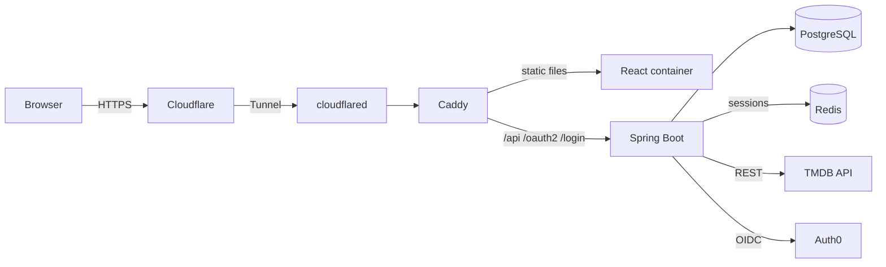

# Watchtime

> A personal film & TV tracker

**Live:** [mywatchtime.app](https://mywatchtime.app)

Watchtime lets you search films and series, log what you watched (including rewatches). It's a solo, non-commercial project.

---

## Features

- Search films and TV series (TMDB)
- Log watches
- Browse watch history
- Login via Auth0

## Tech stack

| Area           | Technology                                                                           |
|----------------|--------------------------------------------------------------------------------------|
| Backend        | Java 25, Spring Boot 4, Spring Security (OAuth2 Client), Spring Data JPA / Hibernate |
| Database       | PostgreSQL 17, Flyway migrations                                                     |
| Sessions       | Redis 8 via Spring Session                                                           |
| Integrations   | TMDB API via `RestClient` + `@HttpExchange`                                          |
| Auth           | Auth0 (OIDC), BFF pattern with session + CSRF cookies                                |
| Frontend       | React + Vite                                                                         |
| Infrastructure | Docker Compose, Caddy, Cloudflare Tunnel, VPS (Ubuntu)                               |
| Operations     | Images on GHCR, Spring Boot Actuator health endpoint                                 |

## Architecture



Everything is served from a single domain, so session and CSRF cookies are first-party: no CORS or third-party cookie issues. The server exposes **no inbound ports** besides SSH; all web traffic arrives through an outbound Cloudflare Tunnel.

## Design decisions

A few choices I made deliberately, and why:

- **Backend-for-Frontend auth.** Spring Boot handles the entire OAuth2/OIDC flow with Auth0. The React app never sees an access token; it only holds an `HttpOnly` session cookie plus a CSRF token cookie. This removes a whole class of XSS token-theft risks.
- **Watches as an event log.** Every watch is a new row instead of a find-and-increment counter. Rewatches come for free (`COUNT(*)`), and history is never lost.
- **Aggregations in SQL, not in memory.** Statistics are computed by the database, which keeps the app lean and the queries explainable.
- **Sessions outside the process.** Spring Session keeps them in Redis, so a redeploy doesn't sign everyone out and a second instance would see the same sessions.
- **Own VPS over managed cloud.** The whole system is hosted on one VPS. The equivalent on AWS would mean RDS, ElastiCache, a load balancer, and a container runtime. More moving parts to wire together and pay for every month. Running it myself keeps every layer configurable.

## Running locally

**Prerequisites:** JDK 25, Docker (for PostgreSQL and Redis), a TMDB API key and an Auth0 application (Regular Web Application).

**1. Start the databases.** Compose also loads `docker-compose.override.yml`, which is what publishes the ports for local access; the base file publishes nothing on its own.

```bash
docker compose up -d
```

**2. Create `.env` in the repository root.** None of these have a default — a missing value stops the application during startup rather than letting it run half-configured.

```properties
DB_HOST=localhost
DB_PORT=5432
DB_NAME=watchtime
DB_USER=watchtime
DB_PASSWORD=watchtime

REDIS_HOST=localhost
REDIS_PORT=6379
REDIS_PASSWORD=watchtime

AUTH0_CLIENT_ID=...
AUTH0_CLIENT_SECRET=...
AUTH0_ISSUER_URI=https://<tenant>.<region>.auth0.com/

APP_FRONTEND_URL=<frontend-origin>
CORS_ALLOWED_ORIGINS=<frontend-origin>

TMDB_API_KEY=...
```

**3. Select a profile.** This one cannot live in `.env`, because that file is only imported once the `local` profile is active. There is no default profile: starting without one fails immediately instead of quietly using production settings.

```bash
SPRING_PROFILES_ACTIVE=local ./mvnw spring-boot:run
```

Auth0 needs the frontend's origin among its allowed logout URLs, and `<frontend-origin>/login/oauth2/code/auth0` among its allowed callback URLs. The callback names the frontend rather than the backend, because the frontend's origin is the only address the browser ever talks to.

All properties live in `application.properties`, with per-profile overrides in `application-local.properties` and `application-prod.properties`.

## Testing

```bash
./mvnw test
```

22 unit tests covering the parts with real branching: recording a season when some episodes are already stored, the guards around missing or unknown episodes, which error a failed delete reports, resolving the signed-in account, and the TMDB response mapping.

## Deployment

Production runs on a single VPS with: cloudflared → Caddy → the React container and Spring Boot → PostgreSQL and Redis.

Images are built locally and pushed to GHCR; the server only pulls.

## Roadmap

- [ ] Favourites, and a watchlist for titles you plan to watch
- [ ] User statistics: time watched, most-watched genres, a yearly recap
- [ ] Ratings
- [ ] Import history from other tracking applications, e.g. TV Time
- [ ] Automated synchronization with the media provider
- [ ] A build and release pipeline, replacing the manual image push
- [ ] Horizontal scaling on Kubernetes

